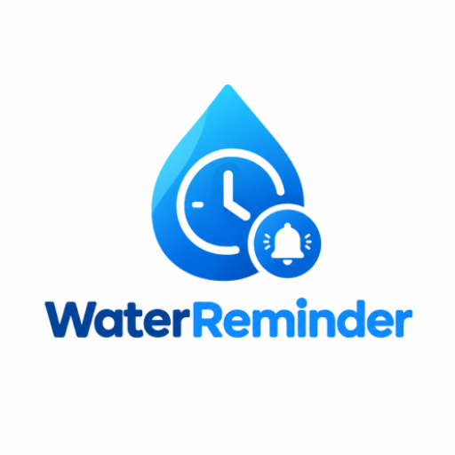

<div align="center">



# 💧 WaterReminder

**Kunlik suv ichish me'yoringizni kuzatib boruvchi va o'z vaqtida eslatuvchi Android ilova**


</div>

---

## 📖 Loyiha haqida

**WaterReminder** — foydalanuvchining vazniga qarab kunlik suv me'yorini hisoblab beradigan, ichilgan suvni animatsiyali stakan orqali ko'rsatadigan va kun davomida belgilangan oraliqda eslatma yuboradigan ilova. Uyqu vaqtida eslatmalar kelmaydi, kunlik maqsadga erishilgach esa ilova sizni tabriklaydi 🎉

---

## 📸 Skrinshotlar

> Skrinshotlarni `screenshots/` papkasiga joylang va quyidagi fayl nomlari bilan saqlang (tavsiya etilgan o'lcham: 1080×2400). Rasm qo'yilmaguncha havolalar bo'sh ko'rinadi.

| Profil yaratish | Asosiy ekran | Boshqa miqdor |
|:---:|:---:|:---:|
|  |  |  |

| Tabrik ekrani | Tarix | Sozlamalar |
|:---:|:---:|:---:|
|  |  |  |

| Bildirishnoma |
|:---:|
|  |

<details>
<summary>📁 Kutilayotgan fayllar ro'yxati</summary>

```
screenshots/
├── profile.png          # Profil yaratish ekrani
├── main.png             # Asosiy ekran (to'lib borayotgan stakan)
├── custom_amount.png    # "Suv miqdorini kiriting" oynasi
├── result.png           # Tabrik / "Oops!" natija ekrani
├── history.png          # Ichilgan suv tarixi
├── settings.png         # Profil va sozlamalar
└── notification.png     # Eslatma bildirishnomasi
```

</details>

---

## ✨ Imkoniyatlar

- 👤 **Profil yaratish** — ism, vazn va uyqu vaqtini kiritish
- 🎯 **Avtomatik me'yor** — kunlik suv miqdori `vazn (kg) × 35 ml` formulasi bilan hisoblanadi
- 🥛 **Animatsiyali stakan** — to'lqinli suv effekti va foizli progress (`WaveWaterGlass`)
- ➕ **Tezkor qo'shish** — bir tugma bilan suv qo'shish, xohlagan miqdorni qo'lda kiritish (100 / 150 / 250 / 750 ml tezkor tanlov) va "Qaytarish" (undo)
- 🔔 **Aqlli eslatmalar** — WorkManager orqali har 30 / 45 / 60 / 90 / 120 / 180 daqiqada
- 😴 **Uyqu rejimi** — belgilangan uyqu vaqtida (standart: 22:00 – 07:00) eslatma yuborilmaydi
- ✅ **Bildirishnomadan to'g'ridan-to'g'ri qayd etish** — "Ichdim (250ml)" tugmasi
- 🏆 **Maqsadga erishish** — kunlik me'yor bajarilganda tabrik ekrani; bajarilmasa motivatsion xabar
- 📜 **Tarix** — barcha yozuvlar, jami miqdor va yozuvlar soni; alohida yozuvni yoki butun tarixni o'chirish
- ⚙️ **Sozlamalar** — profil, eslatma oralig'i va uyqu vaqtini tahrirlash, ma'lumotlarni tozalab qayta boshlash

---

## 🧱 Texnologiyalar

| Yo'nalish | Kutubxona |
|---|---|
| Til | Kotlin 2.2 |
| UI | Jetpack Compose, Material 3, Material Icons Extended |
| Arxitektura | Clean Architecture (`data` / `domain` / `ui`), MVVM |
| Navigatsiya | [Voyager](https://github.com/adrielcafe/voyager) |
| DI | Hilt (+ `hilt-work`) |
| Lokal ma'lumotlar | Room (suv yozuvlari), DataStore Preferences (profil va sozlamalar) |
| Fon ishlari | WorkManager (`PeriodicWorkRequest`) |
| MVI yordamchi | Orbit MVI |
| Rasmlar | Coil |
| Loglash / debug | Timber, Chucker (faqat debug) |
| Build | Gradle (Kotlin DSL), KSP |

---

## 🗂 Loyiha tuzilishi

```
app/src/main/java/com/abdullojon/waterreminder/
├── app/            # Application sinfi (Hilt + WorkManager sozlamasi)
├── data/
│   ├── local/      # Room (AppDatabase, Dao, Entity) va DataStore
│   └── repository/ # WaterRepositoryImpl
├── di/             # Hilt modullari (Database, Repository, Navigation)
├── domain/
│   ├── repository/ # WaterRepository interfeysi
│   └── usecase/    # AddWaterIntake, GetUserProfile, ResetUserData va h.k.
├── navigation/     # AppNavigator, dispatcher va handler
├── receiver/       # WaterNotificationReceiver ("Ichdim" tugmasi)
├── worker/         # WaterReminderWorker (eslatma yuborish)
└── ui/
    ├── components/ # WaveWaterGlass
    ├── main/       # Asosiy ekran
    ├── history/    # Tarix
    ├── profile/    # Profil yaratish
    ├── settings/   # Sozlamalar
    ├── result/     # Maqsad natijasi ekrani
    └── theme/      # Rang, shrift va tema
```

---

## ⚙️ Qanday ishlaydi?

1. Birinchi ishga tushirishda foydalanuvchi **ism, vazn va uyqu vaqtini** kiritadi.
2. Kunlik me'yor hisoblanadi: `dailyGoal = vazn × 35` (masalan, 70 kg → **2450 ml**).
3. `MainActivity` tanlangan oraliq bo'yicha **WorkManager** orqali takrorlanuvchi vazifani ishga tushiradi (minimal oraliq — 15 daqiqa).
4. Har ishga tushganda `WaterReminderWorker`:
   - uyqu vaqti bo'lsa — hech narsa qilmaydi;
   - bugungi ichilgan suv me'yordan kam bo'lsa — bildirishnoma yuboradi.
5. Bildirishnomadagi **"Ichdim (250ml)"** tugmasi `WaterNotificationReceiver` orqali 250 ml ni bazaga yozadi.
6. Me'yorga erishilganda ilova tabrik oynasini ko'rsatadi (kuniga bir marta).

---

## 🚀 O'rnatish va ishga tushirish

### Talablar

- Android Studio (so'nggi barqaror versiya tavsiya etiladi)
- JDK 11 yoki undan yuqori
- Android SDK 37 (`compileSdk = 37`), qurilma/emulyator: Android 7.0 (API 24) yoki yangi

### Qadamlar

```bash
# 1. Loyihani klonlang
git clone https://github.com/<username>/WaterReminder.git
cd WaterReminder

# 2. Debug APK yig'ing
./gradlew assembleDebug

# 3. Qurilmaga o'rnating
./gradlew installDebug
```

Yoki loyihani **Android Studio**da oching va ▶ **Run** tugmasini bosing.

> 🔔 Android 13+ qurilmalarda ilova birinchi ishga tushganda bildirishnomalarga ruxsat so'raydi (`POST_NOTIFICATIONS`). Ruxsat bermasangiz, eslatmalar ko'rinmaydi.

---

## 🛣 Rejalar

- [ ] Haftalik / oylik statistika grafiklari
- [ ] Qorong'i rejim (Dark theme) uchun to'liq qo'llab-quvvatlash
- [ ] Ko'p tilli interfeys (hozircha o'zbek tilida)
- [ ] Bildirishnomadagi miqdorni sozlash
- [ ] Widget

---

## 👨‍💻 Muallif

**Abdullojon** — [`@abdullojon`](https://github.com/abdullojon)

Loyiha yoqqan bo'lsa, ⭐ qo'yishni unutmang!

---

<div align="center">
Sog'lig'ingiz uchun suv iching 💧
</div>
